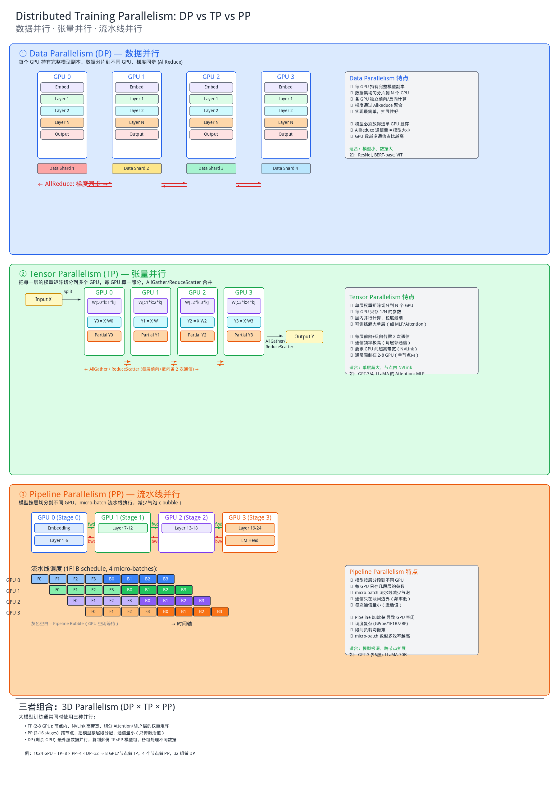

# DeepSeek 3FS vs FSx Lustre — 随机 IO 性能对比

## 测试环境

### DeepSeek 3FS
| 项 | 配置 |
|---|---|
| 版本 | 3FS commit `22fca045` (2026-05-07) |
| 存储节点 | 2 × i3en.xlarge (4 vCPU, 32GB RAM, 1 × 2.5TB NVMe) |
| 元数据节点 | 1 × i3en.xlarge (FoundationDB 7.1.61 + ClickHouse) |
| 客户端 | 同 meta 节点 (FUSE + Native Client) |
| RDMA | SoftRoCE (rdma_rxe 内核模块，软件模拟 RoCE) |
| 网络 | 25 Gbps ENA (Cluster Placement Group) |
| 数据复制 | replication_factor=2, 3 chains, stripe=3, chunk=1MB |
| 区域 | AWS us-east-2 (Ohio) |

### FSx Lustre
| 项 | 配置 |
|---|---|
| 文件系统 | fs-0d45ce2da127d0028 |
| 部署类型 | PERSISTENT_2, Lustre 2.15 |
| 容量 | 1,200 GiB |
| 吞吐档 | 125 MB/s/TiB (合同吞吐 ~146.5 MB/s) |
| 客户端 | MySQL-Master EC2 (单客户端，TCP/ENA) |
| 元数据 IOPS | 未指定 MetadataConfiguration (默认) |
| 区域 | AWS us-east-2 (Ohio) |

### fio 参数
- numjobs=4, direct=1, time_based, runtime=60s, group_reporting
- FUSE / FSx Lustre: ioengine=psync, iodepth=1
- Native Client: ioengine=external:hf3fs_usrbio.so, iodepth=32
- Native Batched: ioengine=external:hf3fs_usrbio.so, iodepth=1024, iodepth_batch_submit/complete=1024

## 随机读性能

| Block Size | 3FS FUSE | 3FS Native (iodepth=32) | 3FS Native Batched (iodepth=1024) | FSx Lustre |
|-----------|----------|------------------------|----------------------------------|------------|
| **4K IOPS** | 3,577 | 5,742 | **173,000** | 5,754 |
| **4K BW** | 14.0 MiB/s | 22.4 MiB/s | **678 MiB/s** | 22.5 MiB/s |
| **8K IOPS** | 3,332 | 5,322 | **149,000** | 7,042 |
| **8K BW** | 26.0 MiB/s | 41.6 MiB/s | **1,164 MiB/s** | 55.0 MiB/s |

## 随机写性能

| Block Size | 3FS FUSE | 3FS Native (iodepth=32) | FSx Lustre |
|-----------|----------|------------------------|------------|
| **4K IOPS** | 386 | 313 | **1,360** |
| **4K BW** | 1.5 MiB/s | 1.2 MiB/s | **5.3 MiB/s** |
| **8K IOPS** | 385 | 313 | **1,401** |
| **8K BW** | 3.0 MiB/s | 2.4 MiB/s | **10.9 MiB/s** |

## 顺序 IO 性能 (bs=1M)

| 测试 | 3FS FUSE | FSx Lustre |
|------|----------|------------|
| **顺序写 BW** | 309 MiB/s | ~146.5 MiB/s (合同) / ~450 MiB/s (突发) |
| **顺序读 BW** | 643 MiB/s | ~146.5 MiB/s (合同) / ~450 MiB/s (突发) |

## 成本对比

| 项 | 3FS (本次测试集群) | FSx Lustre |
|---|---|---|
| 配置 | 3 × i3en.xlarge | PERSISTENT_2, 1.2TiB, 125MB/s/TiB |
| 有效存储容量 | ~2.5TB (replication=2) | 1.2 TiB |
| 小时成本 | $1.36 × 3 = **$4.08/hr** | **~$0.24/hr** ($174/月) |
| 月成本 | **~$2,938** | **~$174** |
| 数据持久性 | ❌ Instance store (停机即丢) | ✅ AWS 托管 |
| 运维复杂度 | 高 (FoundationDB + 5 组件自建) | 低 (全托管) |
| S3 集成 | 无 | ✅ DRA 自动导入导出 |
| RDMA | SoftRoCE (软件模拟) | ENA/TCP (可选 EFA) |

### 读 IOPS 性价比

| | 3FS Native Batched | FSx Lustre |
|---|---|---|
| 4K 随机读 IOPS | 173,000 | 5,754 |
| 每 1K IOPS 小时成本 | $4.08 ÷ 173 = **$0.024** | $0.24 ÷ 5.75 = **$0.042** |
| 每 IOPS 成本 (相对) | **1×** (基准) | **1.8×** |

> 在读密集场景下，3FS Native Batched 模式的每 IOPS 成本比 FSx Lustre 更优。

## 分析

### 3FS Native Batched 读为什么这么快

3FS 的 Native Client 采用类 io_uring 的异步零拷贝架构，绕过了 FUSE 内核模块的三大瓶颈：
1. **内核锁**：FUSE 使用单一自旋锁的共享队列，约 400K 4K reads/s 即饱和
2. **内存拷贝**：FUSE 需要在内核空间和用户空间之间拷贝数据
3. **RPC 开销**：Native Client 将大量小 IO 合并成批量 RPC，显著降低每次请求的固定开销

Batched 模式 (iodepth=1024) 让 3FS 将 1024 个 4K 读请求打包成一次 RDMA 批量操作，即使在 SoftRoCE 上也跑出了 173K IOPS。

### ⚠️ Native Batched 173K IOPS 与真实 DataLoader 的差距

**fio batched 的 173K IOPS 不能直接代表 AI 训练 DataLoader 的真实性能。** 原因如下：

典型的 PyTorch DataLoader 每个 worker 是逐个同步读样本的 (iodepth=1)，即使 32 个 worker 并发，等效并发度也只有 32——远低于 fio batched 的 4 jobs × 1024 = 4096。

| | fio Native Batched | 真实 PyTorch DataLoader |
|---|---|---|
| 单次提交 IO 数 | **1024** | **1** (每 worker) |
| 并发来源 | 单进程高 iodepth | 多 worker 进程 |
| 等效并发度 | 4 × 1024 = **4096** | 32 workers × 1 = **32** |
| IO 模式 | 纯异步批量 | 同步逐个读 |

**不改代码用 FUSE 挂载时**，DataLoader 更接近 Native iodepth=32 那组结果：

| | 3FS Native (iodepth=32) | FSx Lustre |
|---|---|---|
| 4K 随机读 IOPS | 5,742 | 5,754 |
| 8K 随机读 IOPS | 5,322 | 7,042 |

在这个更现实的并发度下，3FS (SoftRoCE) 和 FSx Lustre **基本打平**。

**要吃到 batched 的 173K IOPS，必须改造 DataLoader：**

```
传统 DataLoader (iodepth=1, 同步):
  worker → read(sample_1) → 等完成 → read(sample_2) → ...

改造后 DataLoader (3FS USRBIO API, 异步批量):
  worker → 预取下 N 个 batch 的 sample 列表
         → 用 USRBIO Ior ring 一次提交 N 个读请求
         → 异步等待全部完成
         → 拿到 N 个 sample
```

这需要用 3FS 的 USRBIO Native API 重写数据加载逻辑（替换标准 POSIX read），PyTorch 原生 DataLoader 无法开箱即用。**DeepSeek 内部正是做了全栈改造（文件系统 + 训练框架 + DataLoader），才能发挥 Native Batched 的全部优势。**

总结：
- **不改代码 (FUSE)**：3FS ≈ FSx Lustre，无明显优势
- **改 DataLoader 用 Native Batched**：3FS 173K IOPS >> FSx Lustre 5.7K IOPS，但需要代码改造投入
- **这也是 3FS 的核心门槛**：不只是部署一个文件系统的问题，而是需要整个 AI 训练栈的配合

### 3FS 写为什么慢

1. **CRAQ 链式复制**：每次写必须写链头 → 传播到链尾 → 确认返回，延迟 = 链长 × 单跳延迟
2. **Copy-on-Write**：写操作需要读旧 chunk → 内存合并 → 写新 chunk → 更新 RocksDB 元数据
3. **SoftRoCE 延迟**：软件模拟 RDMA 的延迟远高于硬件 RDMA，写路径的多次往返放大了延迟影响
4. **设计取舍**：3FS 的 CRAQ 协议本身是 write-all-read-any，读优化 >> 写优化

### 公平性说明

⚠️ **这个对比对 3FS 不完全公平**：
- **SoftRoCE ≠ 真 RDMA**：3FS 设计核心是 InfiniBand/RoCE 硬件 RDMA，SoftRoCE 延迟高一个数量级
- **只有 2 个存储节点 / 1 块 NVMe**：生产环境 180 节点 × 16 NVMe，性能线性扩展
- **3FS 生产环境实测峰值**：6.6 TiB/s 聚合读吞吐 (180 节点 + 2×200Gbps IB)

⚠️ **对 FSx Lustre 也不完全公平**：
- 使用了最低吞吐档 (125 MB/s/TiB)，更高档位性能更好
- 单客户端测试，多客户端聚合性能更高
- 未启用 EFA (RDMA)，启用后性能更好

## 适用场景

### 哪些 AI 训练最适合 3FS Native Batched 的大文件随机 4K 读

3FS Native Batched 模式的 173K 4K IOPS 正好命中一类特殊的 AI 训练 IO 模式：**大文件（数百 MB ~ TB）+ 随机 4K 小读**。这和普通 DataLoader（大量小文件顺序读）完全不同。

#### 1. Embedding Table 训练（推荐系统/广告模型）— 最典型

```
Embedding Table (500MB ~ TB级)
┌─────────────────────────────────────┐
│ user_id=0:    [128-dim float32]     │  ← 512 bytes
│ user_id=1:    [128-dim float32]     │
│ ...                                  │
│ user_id=999999: [128-dim float32]   │
└─────────────────────────────────────┘
            ↑ 每个 mini-batch 随机读一批 embedding ≈ 4KB
```

- **模型**：DLRM (Meta)、DeepFM、Wide & Deep、DCN 等推荐/广告模型
- **IO 原因**：Embedding table 存了几百万~几亿个用户/物品的向量，太大放不进 GPU 显存 → 存在 SSD 上，训练时按需随机读
- **IO 特征**：几乎 100% 随机读，每次 0.5-4KB，延迟敏感，读写比极高
- **规模**：Meta DLRM 的 embedding table 可达 TB 级，500MB 只是一个 shard

#### 2. GNN 图神经网络训练（邻居采样）

```
图结构文件 (数百MB ~ 数GB)
┌─────────────────────────┐
│ node_0: [邻居列表+特征]  │
│ node_1: [邻居列表+特征]  │
│ ...                      │
│ node_N: [邻居列表+特征]  │
└─────────────────────────┘
     ↑ 随机采样邻居节点 → 随机 4K 读
```

- **模型**：GraphSAGE、GAT、GCN、PinSage
- **IO 原因**：训练时对每个节点做 neighbor sampling，采到的邻居在文件中的位置是随机的
- **典型场景**：社交网络推荐、金融欺诈检测、知识图谱

#### 3. 向量搜索 / ANN 索引训练与查询

```
向量索引文件 (IVF/HNSW, 数百MB ~ 数十GB)
┌──────────────────────────┐
│ cluster_0: [向量列表]     │
│ cluster_1: [向量列表]     │
│ ...                       │
│ cluster_N: [向量列表]     │
└──────────────────────────┘
     ↑ 训练/查询时随机访问聚类中心和候选向量
```

- **模型/系统**：FAISS IVF 训练、ScaNN、DiskANN
- **IO 原因**：DiskANN 专门为"大索引存 SSD + 随机 4K 读"设计

#### 4. MoE 大模型（推测：3FS 的设计驱动力）

DeepSeek 自家的 MoE 模型 (DeepSeek-V3/V4) 有大量 expert 参数。推理时只激活部分 expert → 需要从存储随机读取被选中的 expert 权重。3FS 的 KVCache 功能（实测单客户端 40 GiB/s 读）很可能就是为这个场景设计的。

#### IO 模式对比

| 场景 | 文件大小 | 单次读 | 读模式 | 关键指标 | 最佳存储 |
|------|---------|--------|--------|---------|---------|
| **Embedding Table** | 500MB ~ TB | 0.5-4KB | 纯随机 | **IOPS** | 3FS Native Batched / 本地 NVMe |
| **GNN 邻居采样** | 数百MB ~ GB | 1-8KB | 纯随机 | **IOPS** | 3FS Native Batched / 本地 NVMe |
| **ANN 索引 (DiskANN)** | 数百MB ~ 数十GB | 4KB 对齐 | 纯随机 | **IOPS** | 3FS Native Batched / 本地 NVMe |
| **MoE Expert 加载** | GB ~ 数十GB | KB ~ MB | 随机 | IOPS + BW | 3FS KVCache |
| 普通图片 DataLoader | 大量小文件 | 几KB~几MB/文件 | 随机选文件 | 元数据 + BW | FSx Lustre / 3FS FUSE |
| Checkpoint 写回 | 单次 GB~TB | 大块顺序写 | 顺序 | **BW** | FSx Lustre |

### 通用场景推荐

| 场景 | 推荐 | 原因 |
|------|------|------|
| **Embedding/GNN/ANN 随机读 (改造 DataLoader)** | **3FS Native Batched** | 173K 4K IOPS，碾压传统文件系统 |
| **普通 DataLoader (不改代码)** | FSx Lustre ≈ 3FS FUSE | 不改代码 3FS 无优势 |
| **Checkpoint 写** | FSx Lustre | 3FS CRAQ 写路径慢 |
| **推理 KVCache** | 3FS | SSD 替代 DRAM，高吞吐读，容量大成本低 |
| **AWS 云原生** | FSx Lustre | 全托管 + S3 DRA + 持久化 |
| **自建 IDC + InfiniBand** | 3FS | 线性扩展到 TiB/s，开源免授权费 |

## 参考

- [3FS GitHub](https://github.com/deepseek-ai/3FS)
- [3FS Design Notes](https://github.com/deepseek-ai/3FS/blob/main/docs/design_notes.md)
- [Fire-Flyer AI-HPC 论文 (arXiv:2408.14158)](https://arxiv.org/abs/2408.14158)
- [FSx Lustre 文档](https://docs.aws.amazon.com/fsx/latest/LustreGuide/)

## 附录：分布式训练并行策略 — DP / TP / PP



### Data Parallelism（数据并行，DP）

**核心思想**：模型不动，数据切分。每个 GPU 持有完整模型副本，数据分片到不同 GPU，梯度通过 AllReduce 同步。

- **通信**：每个 training step 结束时一次 AllReduce，通信量 = 模型参数量
- **优势**：实现最简单（PyTorch DDP 几行代码），线性加速比接近理想，对模型代码无侵入
- **劣势**：模型必须放进单 GPU 显存；AllReduce 通信量 = 模型大小；N 份模型副本浪费显存
- **适合**：模型小于单 GPU 显存（ResNet, BERT-base, ViT），数据量大

### Tensor Parallelism（张量并行，TP）

**核心思想**：把每一层的权重矩阵"竖着切"分给不同 GPU，每 GPU 算一部分，AllGather/ReduceScatter 合并。

- **通信**：**每一层**前向和反向各 2 次通信，频率极高
- **优势**：每 GPU 只存 1/N 参数，突破单 GPU 显存限制；Attention/MLP 矩阵天然适合切分
- **劣势**：每层都通信，必须 NVLink（900 GB/s）；通常限 2-8 GPU（单节点内）
- **适合**：单层超大（GPT-3 hidden=12288），节点内 NVLink 互联

### Pipeline Parallelism（流水线并行，PP）

**核心思想**：模型按层"横着切"成几段分给不同 GPU，micro-batch 流水线执行。

- **通信**：只在 stage 边界传激活值，频率低，每次量小
- **优势**：每 GPU 只存几段层；段间通信量小，适合跨节点；对网络带宽要求最低
- **劣势**：Pipeline bubble（GPU 空闲等待）；调度复杂（GPipe/1F1B/ZBP）
- **适合**：模型极深（GPT-3 96层, LLaMA-70B 80层），跨节点扩展

### 三者组合：3D Parallelism

大模型训练通常同时使用三种并行策略：

```
1024 GPU = TP=8 × PP=4 × DP=32

TP=8 : 节点内 8 GPU (NVLink 高带宽)，切分 Attention/MLP 权重矩阵
PP=4 : 4 个节点串成流水线，每节点负责几段层，通信量小
DP=32: 最外层 32 组数据并行，复制多份 TP×PP 模型组，各组处理不同数据
```

| 维度 | 切什么 | 通信量 | 通信频率 | 带宽要求 | 范围 |
|------|--------|--------|---------|---------|------|
| **TP** | 层内权重矩阵 | 大 | 极高（每层） | NVLink 900GB/s | 节点内 |
| **PP** | 层间（几段层） | 小（激活值） | 低（段间边界） | ~100Gbps 够用 | 跨节点 |
| **DP** | 数据 | 大（梯度） | 低（每step一次） | ~100Gbps | 最外层 |

### 从存储 IO 角度

| 并行策略 | 对存储 IO 的影响 |
|---------|----------------|
| **DP** | 每组读不同数据分片 → N 个进程并发读 DataLoader，总读取量 = 数据集大小 |
| **TP** | 不影响数据读取；Checkpoint 时每 GPU 只写 1/N 参数 → 单文件小但文件数多 |
| **PP** | 不影响数据读取；各 stage 独立写 Checkpoint → 文件数 = stage 数 |
| **3D** | Checkpoint = TP×PP 个分片 × DP 组；DataLoader = DP 组数个并发读流 |
